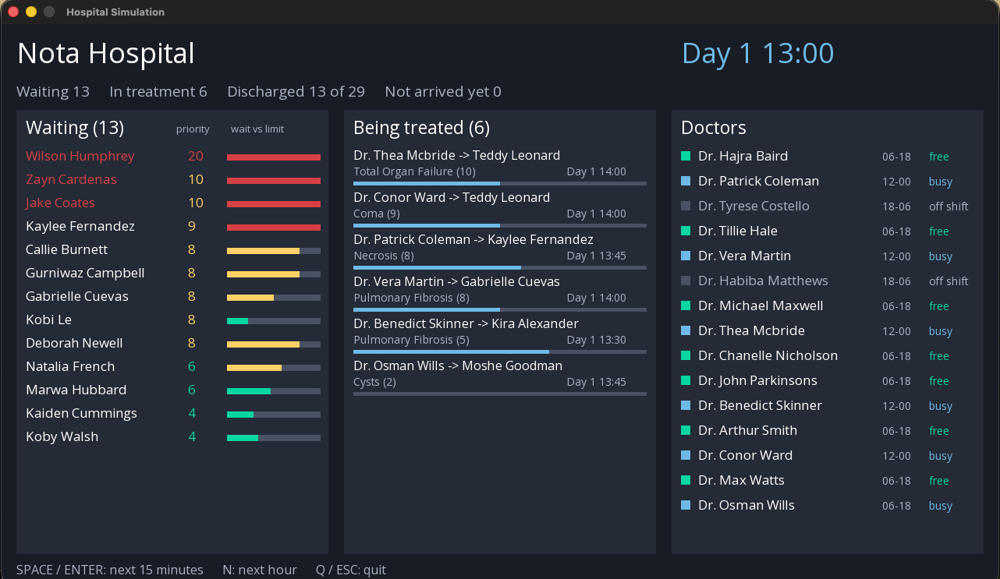
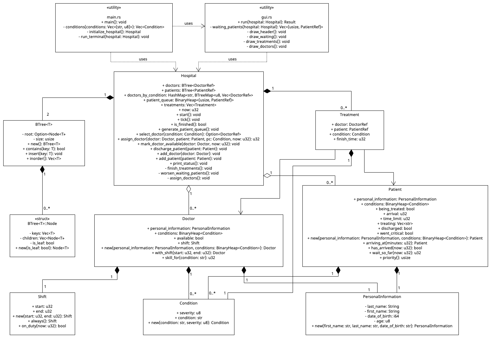

# Hospital-Sim

## Overview

This project simulates the operation of a hospital
as practice for working with data structures.
Patients and doctors are added to the hospital at the start,
and a priority queue of patients
(based on total condition severity)
is generated.
Doctors have conditions they are qualified to treat,
up to a certain severity,
and are assigned to patients with those conditions
for an amount of time based on condition severity.

We make some unrealistic assumptions for this project:
- All diseases are curable
- Diseases are cured in a deterministic amount of time
- Patients are prioritized by total symptom severity
- One doctor treats one disease at a time
- Multiple doctors may be assigned to one patient to treat separate ailments

## Usage

To build the simulation,
execute the following command from the project's root directory:
```sh
make
```

To run the simulation,
execute the following command from the project's root directory:
```sh
make run
```

To remove build artifacts,
execute the following command from the project's root directory:
```sh
make clean
```

## BTree Implementation

For the BTree,
a `t` value of 6 was chosen
to match the [standard library's choice](https://doc.rust-lang.org/src/alloc/collections/btree/node.rs.html#43).
Their choice is informed by benchmarks.

Although we'd love to have calculated `t` based on page size, the calculation
is trickier since our BTree supports generic data and we don't exactly have
child pointers.

## Timekeeping

Time moves in one step (`Hospital::tick`) at 15 mins (`TICK_MINUTES`). The
clock starts at 06:00:D1 (`START_TIME`) and is stored as minutes until midnight
of D1 so that it can run past midnight into day 2, 3, and so forth.

**Tick occurrences**

1. Clock moves 15 minutes and patients who have arrived are announced
   (`Patient::arriving_at`).
2. After treatment free up the doctor (`mark_doctor_available`) and remove the
   cured condition from patient. The patients that have no conditions will be
   discharged.
3. Each patient has a time limit: `(11 - worst severity) * 180` minutes. And
   after it runs out every condition nobody is treating goes up one level per
   tick and can go up to 10.
4. The priority queue is rebuilt because priorities change over time.
5. Free doctors who are on shift take patients from the queue, most urgent
   first.

> [!NOTE]
> Finishing P[2] comes before assigning P[5] so a doctor who has just finished
> can start on a new patient in same tick.

Every doctor has a `Shift` where they start or end at the hour. A shift that ends before it
starts runs over midnight (18 to 6). `select_doctor` only returns doctors who are on duty at
the current time, a doctor who goes off shift still finishes the treatment in progress.
We are using three 12-hour crews: 6-18, 12-24 and 18-6.

Treatment time depends on the condition and the doctor (`treatment_minutes`,
rounded up to whole ticks) `skill` is the highest severity the doctor can treat
for that condition, so a doctor who is more qualified for a condition is faster.
```
base minutes = 30 + 15 * severity
minutes      = base * 10 / (5 + skill)
```

## Visual Component



`make run` opens the SFML window (`src/gui.rs`) and shows the hospital at the
current time. The simulation is the same as before. The window only reads the
hospital and moves the clock, so the terminal log still prints the same messages.

The window has three panels:
- **Waiting**: the patients who are in the hospital with a condition nobody is
  treating, most urgent first. Each row shows the priority (green, yellow, or
  red as it gets higher) and a bar for how much of the patient's time limit
  they have used. The bar turns red when the limit is passed, and the name
  turns red once a condition reaches level 10.
- **Being treated**: one row per doctor -> patient assignment, with the
  condition, the time it ends, and a progress bar.
- **Doctors**: every doctor with their shift, shown as free (green), busy
  (blue), or off shift (gray).

The top of the window shows the clock and the totals (waiting, in treatment,
discharged, not arrived yet).

Controls: SPACE or ENTER moves the clock by one tick (15 minutes), N moves it
by one hour, and Q or ESC closes the window.

The window uses the Open Sans font, under the SIL Open Font License (see `assets/OFL.txt`).

## UML Class Diagram



+ is public and - is private. A filled diamond means the box owns what it points
to, and a hollow diamond means it only holds shared references. A dashed arrow
means "uses". `DoctorRef` and `PatientRef` are shared references
(`Rc<RefCell<...>>`) to a `Doctor` or `Patient`. `main.rs` and `gui.rs` have no
structs, so they are shown as utility boxes.

## Team Member Contributions

| Team Member                                   | Contributions                                                                             |
| :-------------------------------------------: | :---------------------------------------------------------------------------------------- |
| [Daniel](https://github.com/dkcrimson)        | Hospital framework, structs, B-Tree, project base (`models.rs`, `btree.rs`, `main.rs`)    |
| [Alexis](https://github.com/LexisArvay)       | Timekeeping simulation clock, shifts, doctor-patient logic (`models.rs`, `main.rs`)       |
| [Tim(a)](https://github.com/tpolkovnichenko)  | SFML visual component, UML class diagram (`gui.rs`, `main.rs`)                            |
